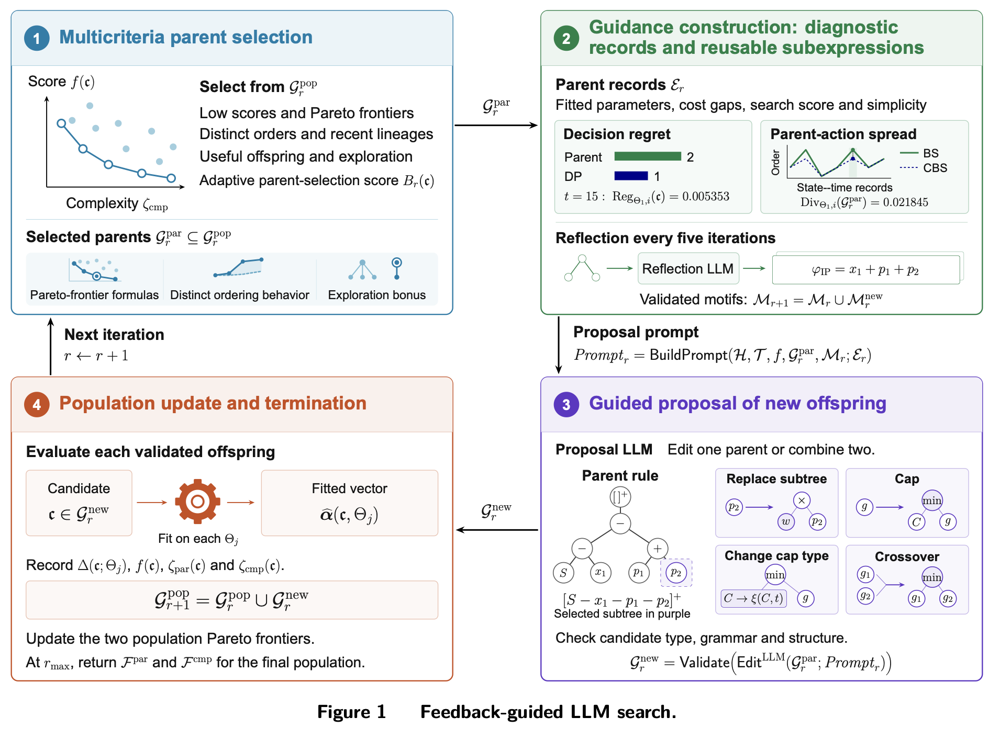

# Agentic Discovery of Simple Symbolic Inventory Policies

Paper: [arXiv:2611.29440](https://arxiv.org/abs/2611.29440).

This repository provides the inventory models, symbolic policy search system, and experiments for the four inventory settings studied in the paper.

## System Architecture



Designing simple inventory policies becomes increasingly difficult as operational features and system configurations expand. We develop an Agentic Inventory-Policy Discovery System based on explicitly defined simple operational formula (SOF) policy and template classes. Large language models (LLMs) revise symbolic structures, while a numerical engine fits parameters separately for each instance and evaluates the induced policies. Multicriteria parent selection, state-specific operational diagnostics, and reusable symbolic motifs guide structural evolution. A three-stage progression develops shared templates across instances and configurations with varying state dimensions. Experiments on 15,600 instances spanning 50 demand distributions cover lead times, perishability, their combination, and lead times with limited customer patience. The discovered templates improve aggregate empirical performance over evaluated SOF benchmarks and are competitive with policies requiring more elaborate online computations. For a lost-sales system with a three-period lead time, we develop an average-cost decomposition and prove that, under specified demand and cost conditions, a capped dual-shortfall specialization of a discovered policy strictly outperforms every policy in the considered capped base-stock benchmark class. This analysis links the performance advantage to the discovered replenishment mechanism. Together, these results highlight the potential of agentic discovery to generate simple inventory policies with strong empirical performance and identify operational mechanisms amenable to rigorous theoretical analysis.

## Environment and Quick Start

Requires Python 3.11, Conda, and Bash.

Run all commands from the repository root:

```bash
conda env create -f environment.yml
conda activate agentic_inv
python examples/compare_policies.py --setting lead_time
```

## Examples

[examples/compare_policies.py](examples/compare_policies.py) fits the policies from the paper and selected baselines, then evaluates them on independent demand paths. Separate cost ranking and fitted parameter tables are printed for L and P.

```bash
# Run all example policies for L and P
python examples/compare_policies.py

# Run one setting, including its paper policies and baselines
python examples/compare_policies.py --setting lead_time
python examples/compare_policies.py --setting perishable

# Fit only the specified policies
python examples/compare_policies.py --setting lead_time --policies cbs SCDS IA-SCDS
python examples/compare_policies.py --setting perishable --policies bsp_low EABS RLCS
```

The examples use the repository optimizer's `fast` mode. Both L and P use 4,096 fitting paths and a proposal budget of 4,096, share the demand distribution `random_pmf_4_m12_alpha1`, and use fixed random seeds with 50,000 independent evaluation paths. Policies are ranked by evaluation cost in ascending order. Cases are defined in `comparison_case()`; see [examples/README.md](examples/README.md) for parameter details.

## Four Inventory Settings and Policies from the Paper

Before searching for policies, fill in the two local JSON files following the [API configuration instructions](configs/README.md). See the [experiment guide](experiments/README.md) for computing resources and stage-by-stage execution.

The following formulas are taken from the paper and represent ordering expressions before rounding. Let $[z]^+=\max\{z,0\}$, with $t$ starting at 0. The cyclic integer cap is

$$
\xi(C,t)=\left\lfloor C(t+1)\right\rceil-\left\lfloor Ct\right\rceil.
$$

$\lfloor z\rceil$ denotes rounding to the nearest integer, with ties rounded to even. Actual actions are rounded and constrained to be nonnegative; the current code additionally imposes an action cap of `n`. $x_m$ is on-hand inventory with $m$ periods of remaining life, $p_1$ is pipeline supply arriving this period, $p_L$ is the latest-arriving supply, and $b_1$ is the youngest backlog cohort.

### 1. Lead Time

A nonperishable lost-sales system with inventory position $\phi_{\mathrm{IP}}=x_1+\sum_{r=1}^{L}p_r$. Define the late-arriving supply summary as

$$
\phi_{\mathrm{tail}}=
\frac{2}{m(m+1)}\sum_{k=1}^{m}(m-k+1)p_{L-k+1},
\qquad m=\max\{1,\lfloor L/2\rfloor\}.
$$

Section 5.1, Eqs. (31)–(32) of the paper give two four-parameter policies:

$$
q_{\mathrm{SCDS}}=\min\{\xi(C,t),K\min\{S-\phi_{\mathrm{IP}},F-p_L\}\},
$$

$$
q_{\mathrm{IA\text{-}SCDS}}=\min\{\xi(C,t),K\min\{S-\phi_{\mathrm{IP}},F-\phi_{\mathrm{tail}}\}\}.
$$

SCDS uses the most recent order quantity to limit consecutive large replenishments; IA-SCDS uses a late-arriving supply summary that varies with the lead time.

```bash
# Policy search: run the complete three-stage symbolic policy search
WORKERS=60 bash experiments/lead_time/run_stage123.sh

# Policy evaluation: refit policy parameters and compare against baselines using MC
bash experiments/lead_time/benchmark_campaigns/inventory_benchmark_family/scripts/run_mc_final.sh \
  --workers 60
```

See [lead_time/README.md](experiments/lead_time/README.md) for details.

### 2. Perishability

A zero-lead-time, FIFO, lost-sales system. Let $\phi_{\mathrm{IP}}=\sum_{m=1}^{M}x_m$ and $\phi_{\mathrm{life}}=\sum_{m=1}^{M}mx_m$. Section 5.2, Eq. (33) of the paper gives:

$$
q_{\mathrm{EABS}}=S-\omega_1\phi_{\mathrm{IP}}+\omega_2x_1,
$$

$$
q_{\mathrm{RLCS}}=
\min\left\{\xi(C,t),S-\omega_1\phi_{\mathrm{IP}}
-\gamma\frac{\phi_{\mathrm{life}}}{1+\phi_{\mathrm{IP}}}\right\}.
$$

EABS uses three parameters to distinguish inventory about to expire; RLCS uses four parameters to combine a remaining-life summary with a cap.
```bash
# Policy search
WORKERS=60 bash experiments/perishable/run_stage123.sh

# Policy evaluation
bash experiments/perishable/benchmark_campaigns/inventory_benchmark_family/scripts/run_mc_final.sh \
  --workers 60
```

See [perishable/README.md](experiments/perishable/README.md) for details.

### 3. Lead Time–Perishability

Let $\phi_{\mathrm{IP}}=\sum_{m=1}^{M}x_m+\sum_{r=1}^{L}p_r$, with $\phi_{\mathrm{tail}}$ defined as in the lead-time setting. Section EC.6.1, Eq. (EC.39) of the paper's appendix gives the three-parameter SCBS and five-parameter ETIS:

$$
q_{\mathrm{SCBS}}=\min\{\xi(C,t),K(S-\phi_{\mathrm{IP}})\},
$$

$$
q_{\mathrm{ETIS}}=\min\{\xi(C,t),
S-\omega_1\phi_{\mathrm{IP}}+\omega_2x_1-\omega_3\phi_{\mathrm{tail}}\}.
$$

SCBS scales the inventory-position shortfall; ETIS adjusts for both inventory about to expire and late-arriving supply.

```bash
# Policy search
WORKERS=60 bash experiments/lead_time_perishable/run_stage123.sh

# Policy evaluation
bash experiments/lead_time_perishable/benchmark_campaigns/inventory_benchmark_family/scripts/run_mc_final.sh \
  --workers 60
```

See [lead_time_perishable/README.md](experiments/lead_time_perishable/README.md) for details.

### 4. Lead Time–Backlog with Limited Patience

Let total backlog be $\phi_{\mathrm{back}}=\sum_{\kappa=1}^{K_{\mathrm{pat}}}b_\kappa$ and net inventory position be $\phi_{\mathrm{IP}}=x_1+\sum_{r=1}^{L}p_r-\phi_{\mathrm{back}}$. Here, $K_{\mathrm{pat}}$ denotes the patience horizon, distinct from the fitted scaling parameter $K$ below. Section EC.6.2, Eq. (EC.40) of the paper's appendix defines

$$
q_{\mathrm{short}}=K\left(b_1+[S_1-\phi_{\mathrm{IP}}-\phi_{\mathrm{back}}]^+\right),
$$

$$
q_{\mathrm{BATS}}=\min\{q_{\mathrm{short}},S_2-\phi_{\mathrm{IP}}\},
\qquad
q_{\mathrm{CBATS}}=\min\{\xi(C,t),q_{\mathrm{short}},S_2-\phi_{\mathrm{IP}}\}.
$$

BATS uses three parameters to limit excessive replenishment driven by old backlog; CBATS adds a fourth parameter for the cap.

```bash
# Policy search
WORKERS=60 bash experiments/lead_time_backlog/run_stage123.sh

# Policy evaluation
bash experiments/lead_time_backlog/benchmark_campaigns/inventory_benchmark_family/scripts/run_mc_final.sh \
  --workers 60
```

See [lead_time_backlog/README.md](experiments/lead_time_backlog/README.md) for details.

## Repository Structure

```text
.
├── README.md
├── LICENSE                          # Apache-2.0
├── environment.yml                  # Python 3.11 and numerical/testing dependencies
├── configs/                         # LLM role configuration templates
├── figures/                         # Screenshot of Figure 1 from the paper
├── examples/                        # Small-scale policy evaluation and parameter fitting
├── src/
│   ├── inventory/                   # Inventory components, transitions, policy ASTs, and motifs
│   ├── evaluation/                  # Exact/MC evaluation, DP references, and caches
│   ├── optimization/                # Parameter domains, parameter fitting, and numerical backends
│   ├── sr/                          # LLM structure search, reflection, and cross-configuration templates
│   ├── runtime/                     # Local process queues, tasks, and atomic artifacts
│   ├── reporting/                   # Score aggregation, result tables, and plots
│   └── tests/                       # Unit and integration tests
├── benchmarks/
│   ├── baselines/                   # Comparison policies for each setting
│   └── inventory_benchmark_family/  # Frozen demands, suites, MC runner, and reporting tools
└── experiments/
    ├── launch.py                    # Training-stage commands and paths
    ├── dispatch.py                  # Training adapters for each setting
    ├── benchmark_campaign.py        # Shared benchmark coordination
    └── <setting>/                   # Each of the four settings contains:
        ├── configs/                 # Ten frozen training environments
        ├── run_stage123.sh          # Three-stage training entry point
        ├── stage1_*/                # Single-instance search and configuration
        ├── stage2_*/                # Multi-instance search and configuration
        ├── stage3_*/                # Cross-configuration search and configuration
        └── benchmark_campaigns/inventory_benchmark_family/
            ├── configs/            # Full MC configuration
            ├── policies/           # Frozen policies and optional AST assets
            ├── mc_model.py         # Numerical adapter for the setting
            ├── scripts/            # Evaluation entry points
            ├── plotting/           # Plotting entry points
            └── runs/               # Retained summaries or new run artifacts
```

## Tests

```bash
PYTHONPATH=src:. python -m pytest -q src/tests
```

## License

The code is released under the [Apache-2.0 license](LICENSE). The paper and its figures are subject to their own licenses.

## Citation

Use the following BibTeX entry to cite the paper:

```bibtex
@misc{chen2026agenticdiscovery,
  title         = {Agentic Discovery of Simple Symbolic Inventory Policies},
  author        = {Xi Chen and Yuze Chen and Baichuan Mo and Jie Ying and Yuan Zhou},
  year          = {2026},
  eprint        = {2611.29440},
  archivePrefix = {arXiv},
  primaryClass  = {math.OC},
  url           = {https://arxiv.org/abs/2611.29440}
}
```
